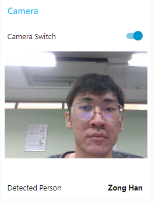
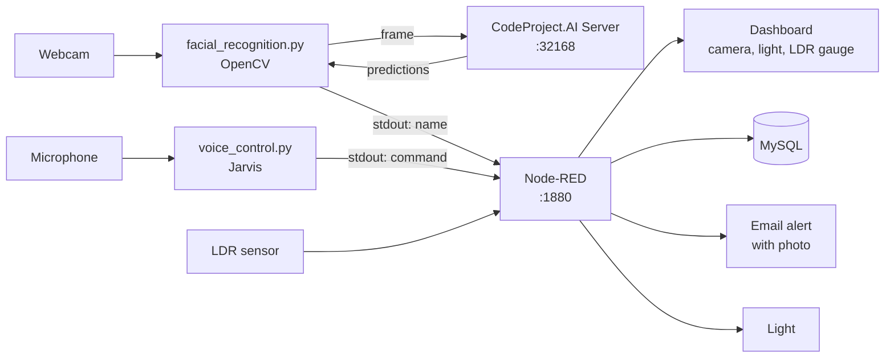
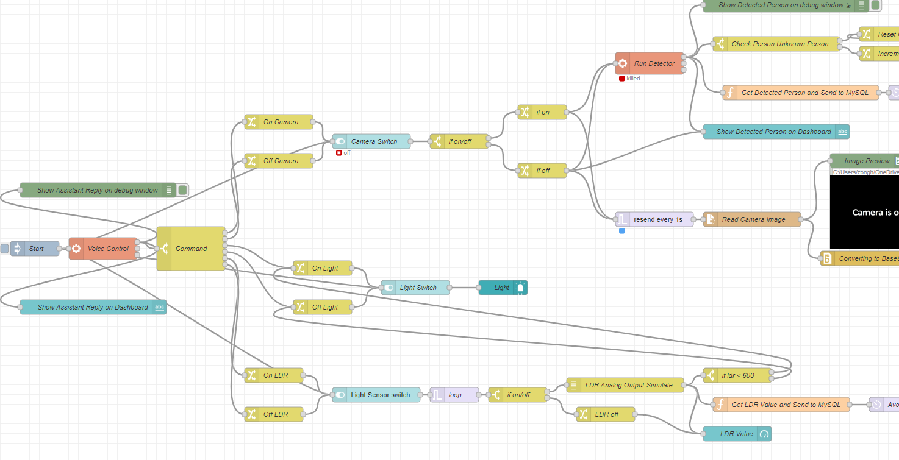
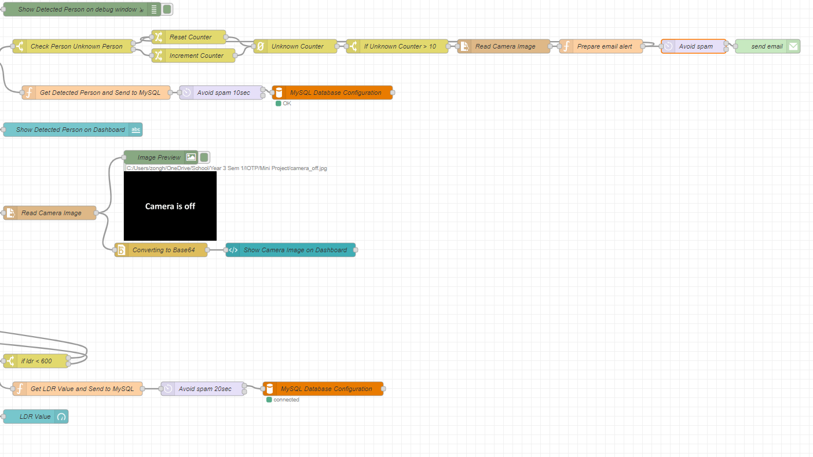
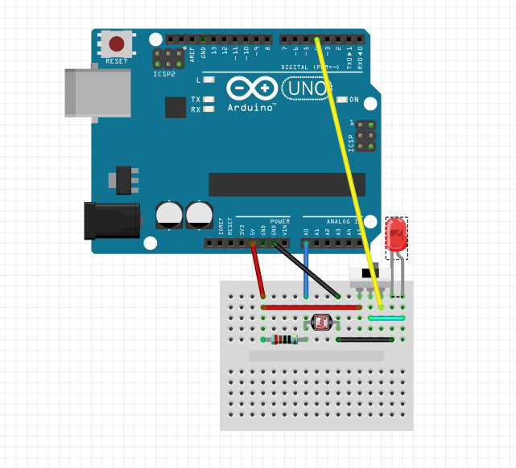
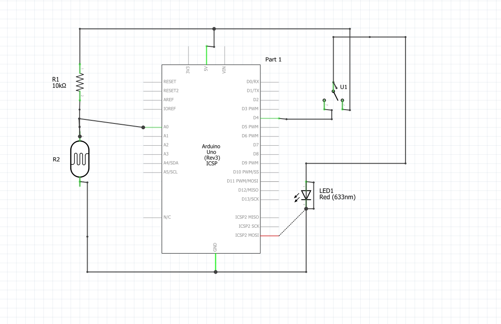
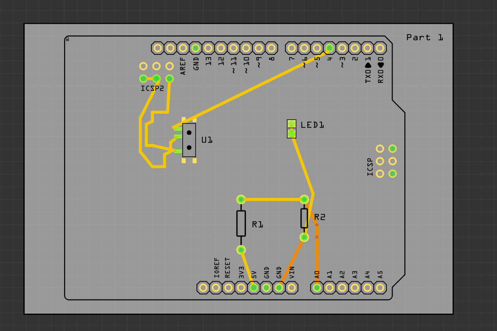

# Smart Light Bulb Camera

An AI-powered home security prototype that combines **facial recognition**, a **voice assistant**, and a **Node-RED IoT dashboard**. The camera identifies who is in front of it, emails the owner a photo when an unknown person keeps showing up, and switches a light on automatically when the room gets dark.

> Built as a two-person mini project for EP0403 IoT Programming (Year 3), 2023.

<p align="center">
  
</p>

## Features

- **Facial recognition**: Captures webcam frames with OpenCV and sends them to a self-hosted [CodeProject.AI Server](https://www.codeproject.com/Articles/5322557/CodeProject-AI-Server-AI-the-easy-way) for face recognition. The recognised name and the live image appear on the dashboard.
- **Intruder alerts**: If an unknown face is detected more than 10 times, Node-RED emails the owner with the intruder's photo attached. A rate limit stops it from spamming.
- **"Jarvis" voice assistant**: Wake-word voice control using SpeechRecognition and pyttsx3. You can say *"turn on the camera"* or *"light off"* to control devices, or ask for the time, simple maths, or a web search.
- **Light-sensor automation**: Reads an LDR (light-dependent resistor) value, plots it on a gauge, and turns the light on when it drops below a threshold.
- **Data logging**: Saves detections (with images) and sensor readings to a MySQL database.
- **Hardware design**: Arduino UNO circuit with an LED, LDR and switch, designed in Fritzing (breadboard, schematic and PCB layout).

## Architecture



Node-RED is the hub. It starts the Python scripts through `exec` nodes and reads what they print to stdout. It then routes those events to the dashboard, the database and email.

## Node-RED Flow



<details>
<summary>Right half of the flow: alerting, MySQL logging and image display</summary>


</details>

## Hardware

| Breadboard | Schematic | PCB |
| --- | --- | --- |
|  |  |  |

The LDR and a fixed 10 kΩ resistor form a voltage divider read on analog pin A0. The LED can be forced on with the slide switch or driven from digital pin 4.

## Tech Stack

| Area | Tools |
| --- | --- |
| AI / Computer vision | CodeProject.AI Server (face recognition), OpenCV |
| Voice | SpeechRecognition (Google Speech API), PyAudio, pyttsx3 |
| IoT / Dashboard | Node-RED, node-red-dashboard |
| Data | MySQL (via XAMPP) |
| Hardware | Arduino UNO, Fritzing |
| Language | Python 3 |

## Project Structure

```
.
├── src/
│   ├── facial_recognition.py   # Webcam → CodeProject.AI → prints recognised names
│   ├── registration.py         # Register a face with the AI server
│   ├── voice_control.py        # "Jarvis" voice assistant
│   └── options.py              # AI server URL and file paths
├── node-red/
│   └── flows.json              # Importable Node-RED flow + dashboard
├── assets/
│   └── camera_off.jpg          # Placeholder shown when the camera is off
├── docs/images/                # Screenshots and hardware diagrams
└── requirements.txt
```

## Getting Started

### Prerequisites

- Python 3.8+ and a webcam and microphone
- [CodeProject.AI Server](https://www.codeproject.com/Articles/5322557/CodeProject-AI-Server-AI-the-easy-way) running at `http://localhost:32168` with the Face Processing module enabled
- [Node-RED](https://nodered.org/) with these palette nodes: `node-red-dashboard`, `node-red-node-mysql`, `node-red-node-email`, `node-red-node-base64`, `node-red-node-random`, `node-red-contrib-counter`, `node-red-contrib-image-output`
- MySQL (for example XAMPP) on port `3307` with a database named `mini_project_ep0403`

### 1. Install Python dependencies

```bash
pip install -r requirements.txt
```

### 2. Register a face

```bash
python src/registration.py path/to/photo.jpg "Your Name"
```

### 3. Create the database tables

```sql
CREATE TABLE facial_recognition (
    id INT AUTO_INCREMENT PRIMARY KEY,
    person_detect VARCHAR(255),
    image LONGBLOB,
    created_at TIMESTAMP DEFAULT CURRENT_TIMESTAMP
);

CREATE TABLE ldr (
    id INT AUTO_INCREMENT PRIMARY KEY,
    value INT,
    created_at TIMESTAMP DEFAULT CURRENT_TIMESTAMP
);
```

### 4. Import the Node-RED flow

1. In Node-RED, choose **Menu → Import** and select `node-red/flows.json`.
2. Replace every `/path/to/smart-light-bulb-camera` with the absolute path to this repo. This appears in the two `exec` nodes and the `if on` / `if off` change nodes.
3. In the **Check Person Unknown Person** switch node, change the known name `Zong Han` to the name you registered.
4. Fill in the credentials for the MySQL config node and the **Intruder alert email** node. These are deliberately left out of the export.
5. Deploy, then open the dashboard at `http://127.0.0.1:1880/ui` and press **Start** to launch the voice assistant.

## Security Considerations

The project also reviewed IoT security risks and how to reduce them:

- **Unauthorised access** to the live feed: enable Node-RED `adminAuth` and dashboard authentication, and use MySQL credentials.
- **Privacy**: position the camera carefully, use privacy zones, and turn the camera off from the dashboard or by voice when it isn't needed.
- **Denial of service**: use firewall rules that only allow known IP addresses to reach Node-RED and the AI server.

## Limitations & Future Work

- The LDR reading and the light are **simulated** in Node-RED (`random` node and dashboard LED). The Arduino circuit was designed but not connected to the flow over serial.
- Face recognition sends every frame to the server. Sending fewer frames would reduce CPU load.
- The voice assistant uses Google's online speech API, so it needs an internet connection.

## My Role

I built the software side: the facial recognition and voice assistant scripts, the CodeProject.AI integration, and the Node-RED flow (dashboard, MySQL logging and email alerts). My teammate, Chua Jia Jun, designed the circuit and PCB in Fritzing and wrote the IoT security analysis.

## Acknowledgements

- Facial recognition loop adapted from [DeepQuestAI/DeepStackExamples](https://github.com/DeepQuestAI/DeepStackExamples)
- Server options pattern from [CodeProject.AI Server](https://github.com/codeproject/CodeProject.AI-Server) Python demos
